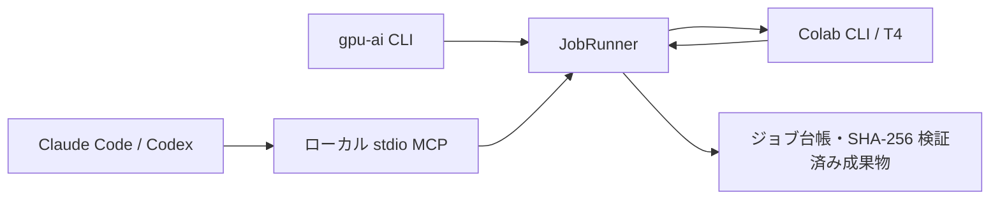

# colab-gpu-ai-hub

WSL2 Ubuntu の Claude Code と Codex から、画像・音声・動画などの推論を Google Colab の GPU に委譲します。ローカルの CLI と stdio MCP は、同じジョブ台帳と成果物ストアを使います。



## WSL2 セットアップ

Python 3.11 以上、uv、FFmpeg（`ffmpeg` と `ffprobe`）が必要です。実機で使う場合は [WSL2 の Colab CLI・OAuth 設定](docs/setup-wsl2.md) と [Claude Code / Codex の MCP 登録](docs/cli-mcp.md) を参照してください。

```sh
uv sync --locked
uv run gpu-ai doctor
uv run gpu-ai run llm_infer --prompt "日本語で短く挨拶してください"
uv run gpu-ai status JOB_ID
uv run gpu-ai results JOB_ID
```

GPU を確保するコマンドは、利用を許可したジョブで実行してください。既定は T4、同じワークスペースでは同時に1ジョブです。完了時と失敗時に自動停止を試み、`cleanup_status` を記録します。`cleanup_pending` の扱いは [診断手順](docs/troubleshooting.md) を参照してください。Colab の無料枠と GPU の空きは変動し、有料プランではコンピューティングユニットを消費する場合があります。 [Colab の利用制限](https://research.google.com/colaboratory/faq.html#resource-limits)

## ワーカーと成果物

各リンクに入力形式、パラメータ、出力、利用モデル、制限、スモーク手順を記載しています。

| ワーカー | 主な入力 → 出力 | T4 検証 |
|---|---|---|
| [Whisper](docs/workers/whisper.md) | WAV・MP3 → 日本語文字起こし JSON・SRT | 確認済み |
| [相対深度](docs/workers/depth.md) | JPEG・PNG → 深度配列・16ビット PNG | 確認済み |
| [Qwen](docs/workers/llm.md) | テキスト → 応答 JSON | 0.5B・3B 確認済み |
| [PaddleOCR](docs/workers/ocr.md) | JPEG・PNG・PDF → OCR JSON・任意の Markdown | 確認済み |
| [画像生成](docs/workers/image_gen.md) | テキスト → 画像と生成条件 | 確認済み |
| [SAM 2.1](docs/workers/sam2.md) | 点・矩形と画像・動画 → マスク・追跡 | 確認済み |
| [動画統合](docs/workers/video.md) | MP4 → 字幕・タイムライン・推定レポート | CPU 模擬で確認済み |

LLM の生成文と SAM 2.1 の追跡はモデルによる推定です。相対深度に物理距離の単位はありません。詳細は [共通契約](docs/contracts.md)、[セキュリティ](docs/security.md)、[ライセンス](docs/licensing.md) を参照してください。

## 開発とテスト

```sh
uv sync --locked
uv run ruff check
uv run pytest -q -m 'not colab_live'
```

通常の GitHub Actions は Python 3.11 と 3.13 の CPU 環境で実行します。合成入力と模擬バックエンドで障害や解放を確認します。GPU と Google 認証は不要です。

実機を明示的に使う場合は、認証済みの WSL2 シェルで次を実行します。短い合成動画について **T4 1件**を要求し、成果物のハッシュ、停止、残存0件を確認します。

```sh
GPU_AI_T4_SMOKE=1 GPU_AI_T4_SMOKE_MAX_SECONDS=600 \
  uv run pytest -q -s -m colab_live
```

実行上限は1〜900秒の範囲で明示し、停止には別に最大60秒を割り当てます。停止未確認時は所有セッションだけを再照会・再停止します。Colab アカウントで許容する費用は実行前に確認してください。CLI からの金額指定に代えて、このテストではランタイム数と実行秒数を制限します。
